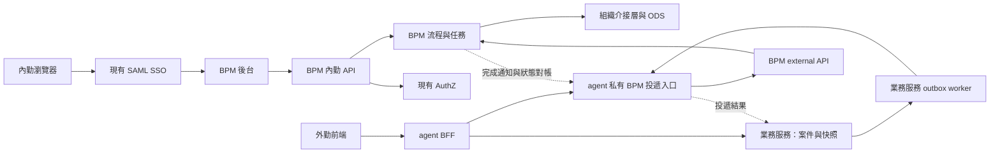

# BPM 內勤後台與 agent BFF 整合規劃

日期：2026-11-05。實作與環境驗收進度見下方批次紀錄。

第 1 項的具體規格已固定於 [內勤與 agent BFF 契約 v1](contracts/staff-agent-v1/README.md)，包含 API 欄位、權限碼、錯誤、schema 正反例與行為驗收案例。欄位與映射以 v1 契約為準。

## 目標與確定邊界

依使用者本次確認：**BPM 後台只支援內勤登入與簽核；外勤一律透過 agent BFF 呼叫 BPM API。** 此決定取代先前「內勤先、外勤之後加入 BPM 登入」的假設。外勤登入不列入 BPM 後台後續階段。

實作採兩個入口：內勤 SSO 使用者入口，以及 agent 的服務間 API 入口。沿用現有 SAML、AuthZ、ODS 與 BPM 外部 API，補齊各入口的身分、授權與可靠投遞契約。BPM 不新增企業登入服務，也不重建 AuthZ。

「外勤可呼叫 API」不自動等於「可以代理內勤簽核」。首批支援外勤送件、查詢與業務定義的補件；內勤人工任務仍由持有該任務的內勤完成。日後若有外勤核決需求，需獨立定義外勤任務與核決政策，不放寬現有系統任務接口來代簽。

## 目標架構

圖中的私有投遞入口是待建能力。業務服務呼叫的是 agent 的服務間入口，不會遞迴呼叫瀏覽器入口。查詢亦先核對業務案件可見範圍，再經 agent 取得允許揭露的 BPM 狀態。

| 責任 | 所有者 | 契約邊界 |
|---|---|---|
| 內勤登入、換發 JWT、SSO 登出 | SAML 服務 | BPM 驗證簽章及允許的身分來源；不收集內勤密碼 |
| 內勤是否可使用後台 | BPM | 驗證內勤資格及後台存取權；不能只檢查 JWT 有效 |
| 內勤功能權限 | AuthZ，BPM 執行判定 | 個人與組織主體聯集；表單、部署、稽核權限分離 |
| 內勤任務持有、候選人與流程狀態 | BPM | 功能權限不取代案件／任務授權 |
| 外勤登入與請求身分 | agent 既有 middleware | 由驗證後的 UserContext 取 actor，不信任瀏覽器提供的身分標頭 |
| 外勤案件可見範圍、申請快照、補件規則 | owning 業務服務，agent 協調 | 先查業務授權，才送 BPM；個人權限不能由服務 API key 取代 |
| 外勤通道對 BPM 的 HTTP 呼叫 | agent | 使用專用服務憑證與有限動作；不轉送外勤 JWT 至 BPM 一般 API |
| 流程定義、指派、表單版本、稽核 | BPM | 不接受瀏覽器自由指定內勤受理人、流程 key 或保留變數 |
| 投遞意圖、防重與結果不明狀態 | owning 業務服務 | 保留已存在的 outbox；agent 負責 transport，不複製另一套業務案件狀態 |

## 已查證的整合契約與缺口

下列是本機工作副本的程式契約，不代表正式環境已部署或可連線。BPM 基準為 `d1900de`，agent 為 `b76624cb`；登入與授權來源亦經原始碼核對。既有全回歸證據見 [11 月 5 日驗證紀錄](../handoff/2026-11-05-full-regression.md)，不把該次 mock 驗證視為本規劃已完成整合。

### 內勤登入

| 項目 | 現有實作 | 待補契約 |
|---|---|---|
| SSO 入口 | SAML `GET /saml/v1/get-jwt` 轉導；`POST /saml/v1/token` 以 query/form `code` 換 token。交換碼 TTL 60 秒、單次消耗 | BPM 落點加入 SAML returnUrl 與 handoff 設定，固定用 code，不把 JWT 放在網址；處理交換失敗、過期、重複兌換與返回原頁 |
| Token | SAML RS256；`sub` 為解析後 USERID，含 `office_code`；簽章依來源使用 issuer/audience/key，`kid=audience` | 逐環境固定允許的 issuer、audience、公鑰／kid 組合；驗證內勤資格，不以 issuer 或 `office_code` 非空判定內勤 |
| BPM 驗章 | `JwtDecoderConfig` 正式模式使用 `JwtDecoders.fromIssuerLocation`；前後端使用 `sub` | 查到的 SAML 程式未提供 OIDC discovery/JWKS。先增加受控 RSA 公鑰驗證模式與 audience 檢查；保留 OIDC 模式，但不假定填 SAML URL 即可使用 |
| 後台登入 | `App.vue` 仍為開發登入／貼 JWT；`session.js` 用 localStorage | 改為 SSO 導向、code 交換、session 初始化與過期處理。登入後由後端提供標準 userId／權限，前端不自行猜身分 |
| 登出與停權 | SAML 有 session 登出；BPM 目前只驗 JWT，沒有已確認的 SAML session 撤銷接線 | 明確定義應用登出與 SSO 登出；確認既發 JWT 的撤銷窗口、內勤停權來源與檢查時點 |

SAML 查組織失敗時仍可能以原始登入識別碼簽 token；因此 **JWT 簽章成功不能代替 USERID 存在且屬於可登入內勤的查核**。Staff 的實際 AuthZ 身分來源是 JWT `sub`，`UserContext.nameId` 是內部名稱，不應另找不存在的必填 `nameid` claim。

來源：[SamlAuthController](../../../saml/src/main/java/com/nanshan/saml/adapter/in/SamlAuthController.java)、[SamlAuthUseCase](../../../saml/src/main/java/com/nanshan/saml/application/v1/SamlAuthUseCase.java)、[JwtHandoffStore](../../../saml/src/main/java/com/nanshan/saml/application/v1/JwtHandoffStore.java)、[BPM decoder](../../bpm-core/src/main/java/com/bpm/core/security/JwtDecoderConfig.java)、[StaffAuthzIdentity](../../../staff/src/main/java/com/nanshan/core/middleware/authz/StaffAuthzIdentity.java)。

### 內勤組織與權限

| BPM 需要 | 現有來源 | 差異與處理 |
|---|---|---|
| 使用者、所屬單位、單位成員 | MASA ODS `StaffEmployee.UserId`、`ParentOrgCode`、`OrgNode`；Staff 有組織樹業務 API | ODS 可沿用，但 Staff 業務 API 不是 BPM OrgRestClient 的現成同形接口；需要明確 adapter |
| 直屬主管、主管鏈、代理人 | BPM 目前期待 `/api/users/{id}/manager`、`manager-chain`、`substitute` | 已檢視的 ODS 模型沒有主管、代理期間與在職旗標。需確認權威來源與資料新鮮度；組織父節點不能當成人員主管 |
| 部門碼 | ODS 有 organization object ID、nodeCode；JWT 有 office_code | 建立對照並選一個 BPM deptId。不可把 Office Code 與 Object ID 直接視為相同 |
| 個人權限 | AuthZ `POST /api/v1/grants/subjects/profiles/query` 支援批次主體與 system_code | Staff 使用 `staff-` 加 `org-<office_code各段>`；BPM 目前只傳單一 userId。需取得可靠組織主體並聚合，主體正規化與 ODS USERID 大小寫規則分開處理 |
| 即時權限判定 | AuthZ `POST /api/v1/sdk/permissions/check`，JSON 為 subject_ids、system_code、permissions、mode、subject_attributes | 原始碼確認成功 code 為字串 `0000`；effectiveSubjectIds 是 Java method，非 wire 欄位。ABAC 需走實際 check，不以 profile 權限清單代替條件判定 |
| 依權限找簽核人 | AuthZ 有 `/api/v1/policy/resources/subjects/query` 與角色主體查詢 | 只有部分可沿用：資源查詢有分頁、可能回組織主體，不能直接當「某一 action 的員工清單」。需依 permission 精確篩選、展開組織、處理有效期，必要時逐候選 check |
| 權限字彙 | BPM 有 `bpm:form:design`、`audit:log:read` 等；AuthZ 業務慣例為四段碼 | 建立明確映射表，逐筆包含 BPMN 候選群組與部署權限；不能機械加前綴。先保留 BPM 內部碼，由 adapter 對外映射，再評估移轉 |
| 授權來源 | BPM `roles` claim 非空時跳過權限中心 | 正式內勤模式以 AuthZ 為權威；不得讓通用 JWT `admin`／`*` 自動取得 BPM 管理權，亦不得以 stale roles 繞過撤權 |
| 下游認證 | OrgRestClient／PermRestClient 目前僅能設定一個共用 header 名稱與各自 token | AuthZ profile/resource API 要 `X-Subject-Id` 且受 admin 角色及細權限雙閘；Staff API 通常還要 API key＋JWT。需專用 typed client、服務身分與 envelope/error 處理，不能只改 URL |

AuthZ SDK check 不經 admin interceptor，不表示外網匿名可用；實際服務間入口、網路限制與憑證由環境契約確認。若沿用 admin-gated profile/resource 查詢，配置僅有必要讀權限的服務帳號；不要共用人員管理員帳號。後續可把熱路徑查詢收斂到專用 SDK API。

BPM 的 ODS `DepartmentMembersSource` 目前只提供表單選項，不能替代完整 `OrgService`。內勤後台的候選人資料源固定使用 staff namespace，外勤資料只出現在外部案件必要的申請人／操作人資訊。

來源：[OrgRestClient](../../bpm-core/src/main/java/com/bpm/core/client/OrgRestClient.java)、[PermRestClient](../../bpm-core/src/main/java/com/bpm/core/client/PermRestClient.java)、[SecurityConfig](../../bpm-core/src/main/java/com/bpm/core/security/SecurityConfig.java)、[OrgService](../../bpm-core/src/main/java/com/bpm/core/service/OrgService.java)、[ODS model](../../../staff/masa/src/main/java/com/nanshan/masa/ods/model/StaffEmployee.java)、[AuthZ SDK 契約](../../../authz/docs/api/sdk-gateway.md)、[SubjectGrantController](../../../authz/src/main/java/com/company/authz/modules/grant_management/api/SubjectGrantController.java)、[ResourceSubjectQueryController](../../../authz/src/main/java/com/company/authz/modules/policy_admin/api/ResourceSubjectQueryController.java)。

### agent 與 BPM 外部 API

| 能力 | 現有 BPM 契約 | 新架構的處置 |
|---|---|---|
| 服務認證 | `X-System-Id`＋`X-API-Key`；另查啟用狀態、IP、allowedActions；支援 key 輪換 | 配置 agent 專用 systemId／key。與瀏覽器進 agent 的 API key 分開；不轉送外勤 Bearer、NSL headers 或 `X-User-Id` 至內勤入口 |
| 啟流程 | `POST /api/external/process-instances`；processDefinitionKey；server 固定 `initiator=system:<id>`、`_externalSystemId` | 保留機器發起者；新增獨立的可信外勤 actor 與業務案件參照，不覆寫 initiator |
| 代發與首關 | onBehalfOf 需額外授權並查已知人員；需合法 firstTaskAssignee／candidateGroups 或代發身分 | 不把外勤 agentCode 塞成內勤 onBehalfOf。由 BPM 的流程路由政策選內勤受理人／群組，BFF 不接受瀏覽器指定 |
| 查詢 | `GET /api/external/process-instances?businessKey=...`；`GET /api/external/process-instances/{id}/status` | 目前僅檢查系統擁有權。agent 必須先以業務案件 ID 查 owner／scope，再讀 server-owned BPM reference；禁止任意 processInstanceId 代理查詢 |
| 完成任務 | `PUT /api/external/tasks/{taskId}` 只允許 assignee 或 candidateUsers 明確含 `system:<id>` | 首批不給 agent `complete_task`。補件建明確業務動作與狀態契約；若確需系統任務，由 BPM 配置專用節點，不能藉它核准內勤人工任務 |
| 範圍設定 | allowedProcessKeys 新寫入必填；actions／candidateGroups／workerTopics 的 null 可代表不限 | 建立 agent 整合設定時全部明填；首批 actions 只列 start_process、query_status，未用的 workerTopics 明填空陣列 |
| 版本 | 外部啟動目前用 `startProcessInstanceByKey`；BPM 在啟動時鎖表單版本 | 缺呼叫端指定確切流程／表單版本並比對的契約。正式送件需增加鎖版入口，版本不符明確拒絕，不靜默採最新版本 |
| 防重 | businessKey 可查詢，但不是啟動唯一鍵／冪等保證 | BPM 增加以 systemId＋requestId 的持久防重、payload hash 與結果查詢；同 key 不同內容回衝突，並發最多建立一案 |
| 結果 | status 回 running／completed 等與簡化 result/currentTasks | 不足以表達所有退回、取消、業務審核結論及版本。補權威 review outcome、processDefinitionId、revision；無可靠對應維持 UNKNOWN |
| 通知 | BPM outbound webhook 簽實際 raw body；投遞生成 deliveryId | agent 驗簽後只做喚醒／對帳，不能把 deliveryId 當穩定業務事件 ID。去重與亂序以穩定事件／狀態 revision 處理 |

agent 既有 JWT middleware 已驗簽並建立 UserContext，但本次看到的驗證沒有顯式 audience 比對；增加 BPM BFF 功能前一併補 issuer／audience／使用者類型綁定。NASA 外勤 JWT 的 `sub` 目前為固定值，個人識別在 `agentCode`；這是 **agent 的身分正規化責任**，不需要因此擴充 BPM 後台的外勤登入能力。不能直接沿用 recruitment adapter 的 account 作為所有 BPM 業務的外勤識別。

擬定 actor 契約：服務身分由 API key 解析；actor 記錄獨立的 type、受驗證來源與 agentCode／subject；requestId、businessKey、processInstanceId、traceId 串接稽核。actor 由 agent 的驗證後 context 或已保存且可信的業務投遞意圖產生，瀏覽器傳同名欄位須拒絕或丟棄。**actor 是可追溯的人，不是取得內勤角色的捷徑。** 非同步投遞不保存原始 Bearer／SAP ticket；投遞時仍核對案件狀態與授權有效性。

來源：[ExternalApiAuthFilter](../../bpm-core/src/main/java/com/bpm/core/external/ExternalApiAuthFilter.java)、[ExternalApiController](../../bpm-core/src/main/java/com/bpm/core/external/ExternalApiController.java)、[ExternalSystemAuthorizationValidator](../../bpm-core/src/main/java/com/bpm/core/external/ExternalSystemAuthorizationValidator.java)、[WebhookConsumer](../../bpm-core/src/main/java/com/bpm/core/webhook/WebhookConsumer.java)、[agent JwtValidMiddleware](../../../agent/src/main/java/com/nanshan/agentportalservice/core/middleware/JwtValidMiddleware.java)、[NASA AgentAuthorizeBase](../../../nasa/src/main/java/com/nanshan/authorization/application/v1/AgentAuthorizeBase.java)。

### 與既有增員流程的銜接

agent 目前的增員 BFF 呼叫 recruitment，尚無正式直連 BPM adapter。recruitment 已有 `TalentBpmPort`、持久投遞 worker 與明確 dev-only provider；正式能力未配置時不會退回 mock。其送件契約包含快照、確切流程／表單版本、UNCERTAIN 對帳與歷程保存，不能由新 BFF 繞過。

依本次 agent 作為 BPM 呼叫端的邊界，建議接線為：**recruitment 保存快照/outbox → 既有 worker 經新的 adapter 呼叫 agent 私有投遞入口 → agent 呼叫 BPM → 結果回存 recruitment**。這是待實作的路徑調整，不宣稱 recruitment 已有正式 BPM HTTP client。agent 私有入口只接受授權業務服務的投遞命令；沒有已建立的案件／submission，不提供任意啟流程 proxy。

持久防重由 BPM 最終保證；業務 outbox 保留派送與對帳狀態。agent 不對不明結果自行重送 start。新增的 BPM 冪等契約完成前，延續既有「UNCERTAIN 先查詢、空結果也不直接當成可重送證明」的規則。每個 submission 只保留一條投遞路徑，避免新舊 adapter 同時啟動。

此銜接不改變 TALENT 與 AGENT 的既有身分區隔，也不把外勤管理者升權成本人申請人。各業務前端仍使用其專屬 API；業務所有權由核心再次核對。

v1 契約先固定 AGENT transport 與內勤簽核；recruitment TALENT 本人的正式投遞仍需另外擴充 actor 契約，不能直接改標 AGENT 接線。首批使用合成 `bff-contract-review` 驗證雙入口，正式業務流程與憑證另作環境綁定。

來源：[agent 增員契約](../../../agent/docs/features/recruitment/phase2-api.md)、[共同送件契約](../../../recruitment/docs/features/organization-recruitment/phase2-api.md)、[TalentDeliveryWorker](../../../recruitment/src/main/java/com/nanshan/masa/recruitment/application/TalentDeliveryWorker.java)、[DevelopmentTalentBpmAdapter](../../../recruitment/src/main/java/com/nanshan/masa/recruitment/adapter/talent/DevelopmentTalentBpmAdapter.java)。

## 具體實作順序與驗收

2026-11-06 第 6 項的跨服務瀏覽器驗收、故障矩陣、依環境切換與回退順序見[整合驗收與切換](../handoff/2026-11-06-integration-cutover.md)。正式放行須補齊手冊中的權威來源。

2026-11-06 第 5 項已實作。依新增決定，準增員本人可用 TALENT actor 啟動指定流程。recruitment 的 worker 驗收、正式來源缺口與三庫重跑方式見[撤權與同步交接](../handoff/2026-11-06-revocation-sync.md)。

2026-11-05 第 2 項實作：批次 1／2 的 BPM 消費端與內勤垂直流程已接線，見 [內勤整合指南](../api/staff-sso-integration.md)。正式身分橋接、IdP／AuthZ 設定與主管／代理等來源能力尚待提供；不以本機合約 provider 測試宣稱正式環境整合完成。

| 批次 | 修改範圍與交付物 | 完成門檻 |
|---|---|---|
| 0 契約與範例固定 | 已交付 [v1 契約](contracts/staff-agent-v1/README.md)：內勤 USERID、AuthZ 主體與權限、AGENT actor、版本／防重／錯誤、合成流程與跨人案例 | 文件與 schema 檢查已完成；正式環境綁定、43 項行為驗收於後續實作完成 |
| 1 內勤認證與入口隔離 | BPM `JwtDecoderConfig`、啟動驗證、SecurityConfig、MeController；前端 SSO callback/session；SAML 環境落點設定 | 真實內勤 SSO 可進後台；外勤有效 JWT、服務 key、偽造 USERID 均不能進內勤 API；錯 issuer/aud/key、過期與停權拒絕 |
| 2 組織與 AuthZ adapters | typed Org/AuthZ clients，沿用 OrgService／BpmPermissionService 呼叫面；移除正式模式 roles 優先；候選群組映射與最小權限 seed | 內勤登入、候選待辦、認領、簽核貫通；同組／跨組／無權三組驗收；代理／主管資料不足時阻止相應流程上線 |
| 3 BPM 外部送件契約 | ExternalApiController 拆出可測試的啟動服務；新增鎖版、防重、actor、明確 review/revision；保留既有系統任務守衛 | 同 requestId 並發只啟一案；內容衝突拒絕；新版本部署不改已指定版本；agent 無法代簽內勤任務；跨 systemId 查不到案件 |
| 4 agent BFF 與業務投遞接線 | agent feature usecase/port/outbound adapter、私有投遞與查詢入口；recruitment 的正式 port adapter 指向 agent；DTO camelCase↔snake_case 與錯誤轉譯 | 同一 agent systemId 下兩位外勤不能互讀／互改；瀏覽器 actor/owner/key 不生效；只投遞已保存 submission；結果不明不回假成功 |
| 5 撤權與狀態同步 | Org/AuthZ 異動接 BPM 快取失效；agent webhook 驗簽、授權對帳、投遞回存；保留失敗重試與稽核 | 調職／停權／代理到期符合約定時限；重複／亂序通知不倒退狀態；舊 submission 不覆寫新案件；服務重啟可恢復對帳 |
| 6 整合驗收與切換 | 後端、前端、跨服務與瀏覽器 E2E；按環境開關切換真實來源，保留回退程序 | 完整路徑：外勤前端→agent→業務快照→agent→BPM→內勤 SSO 簽核→外勤查結果；故障矩陣通過後才移除正式 mock 設定 |

依賴順序為 **0 → 1 → 2 → 3 → 4 → 5 → 6**；第 2 批來源契約確認與第 3 批 API 設計可同時準備。第一個可交付垂直切片是「內勤 SSO＋真實權限＋一個可簽任務」；第二個才是「外勤經 agent 送件，內勤簽完後可查結果」。不能把登入成功當成正式整合完成。

agent 新程式沿用 `Controller → UseCase → Port → Adapter`，對瀏覽器採現行 GET／POST action route 與 snake_case envelope；BPM 外部 wire contract 在 adapter 轉換。禁止把 BPM 通用管理 API 原封不動代理出去。此階段不導入新的共用 SDK；BPM 是 Boot 4/Jackson 3，不能直接搬入 Staff 的 Boot 3/Jackson 2 middleware。

## 生效時限與尚需取得的資料

目前 BPM 權限清單與全域持有人快取 5 分鐘、部門權限持有人 10 分鐘；主管／部門一般快取 60 分鐘、成員 30 分鐘、代理人 1 分鐘。已有 `/api/internal/cache-invalidate/org` 與 `/perm`，需 `ROLE_GATEWAY`；調職須提供舊／新部門與受影響使用者。**不因 agent 需要外部 API 而授予它 ROLE_GATEWAY。** 失效通知使用另外受控的服務身分。

投產前需確認的資料，先列為施工依賴而非要求使用者現在提供憑證：

1. SAML 各環境內勤 issuer/audience/public key、BPM callback origin、登出與停權時限。敏感值透過既有 secret 管理提供。
2. 內勤有效名冊、直屬主管、代理有效期間的 owner／介面，以及 ODS 同步新鮮度承諾。
3. AuthZ 的 BPM system code、權限映射、讀取服務帳號與撤權通知。組織異動需同時重算組織授權，不能只清 ODS cache。
4. 首支業務流程的確切定義／表單版本、內勤受理規則、外勤允許動作與可揭露結果。已派發任務遇撤權／離職時要重派或凍結，由 BPM 規則明定。
5. agent→BPM 專用服務設定、私有投遞入口的呼叫者白名單與 webhook 目的地。所有投遞／查詢須能追到 businessKey、submission、requestId 與實際 actor。

## 2026-11-05 初版交付範圍

本次只建立架構與實作計畫，並更新計畫索引；未修改服務程式、資料庫、憑證或部署設定。文件核對來源、相對連結與 Git whitespace，不重跑程式測試；真實 SSO、AuthZ、組織來源與跨服務 E2E 留在上述批次驗收。未建立新 commit，未 push。
